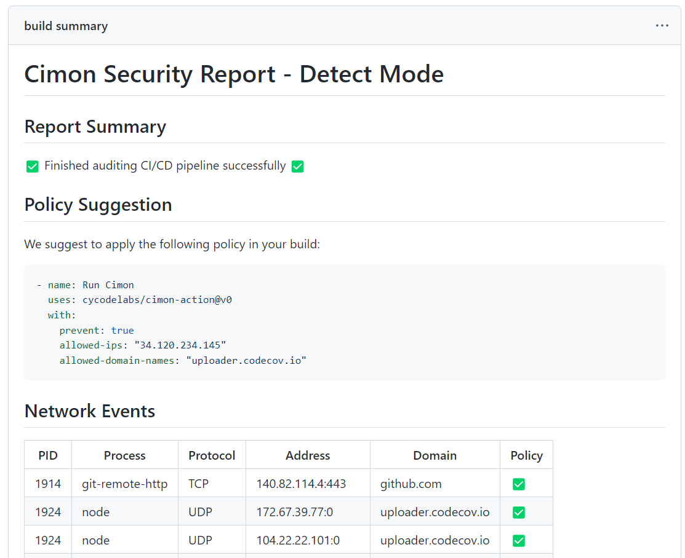
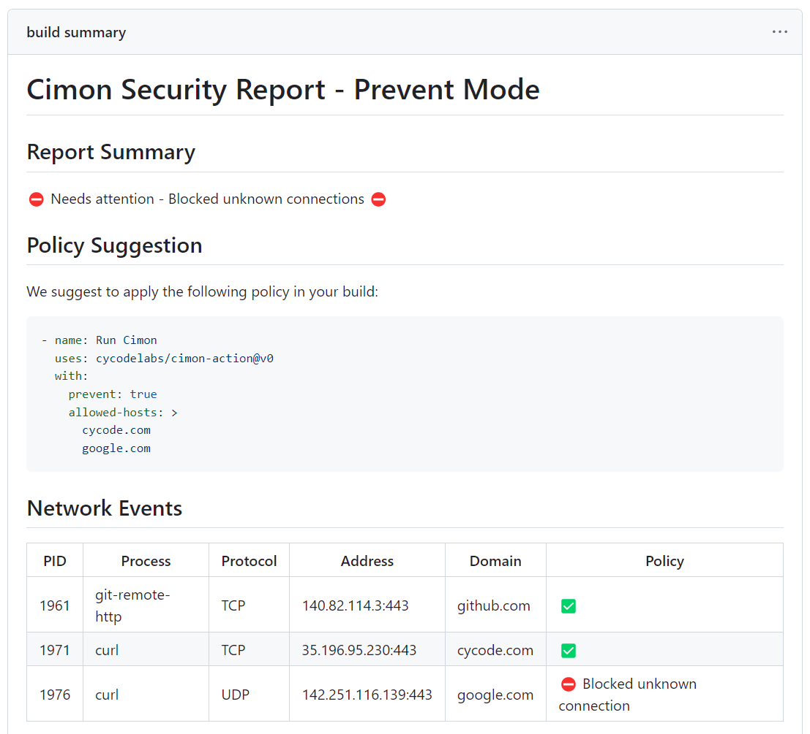

# 🦫 Secure your CI with Cimon


<a href="https://cycode.com/cygives/" alt="Cimon is part of Cygives, the community hub for free & open developer security tools."/>
  <picture>
    <source media="(prefers-color-scheme: dark)" srcset="./assets/images/Cygives-darkmode.svg">
    <source media="(prefers-color-scheme: light)" srcset="./assets/images/Cygives-lightmode.svg">
    
  </picture>
</a>

[Cimon](https://cimon.build) (pronounced "Simon") is a runtime security solution that detects and stops software supply-chain attacks on your pipeline, including those targeting SolarWinds and CodeCov, through easy onboarding and a developer-friendly experience.

By utilizing the revolutionary eBPF technology, Cimon monitors and mitigates attacks within the kernel, denying access to users' assets as soon as they arise.

This action helps seamlessly deploy the agent into any desired GitHub Actions build. The action is based on the NodeJS engine and contains simple `pre` and `post` scripts to deploy and gracefully shut down the agent.

Learn more about Cimon in our [docs](https://docs.cimon.build).

## 🖥️ Supported platforms

| Runner OS | `cycodelabs/cimon-action` (agent) | `cycodelabs/cimon-action/attest` |
| --------- | --------------------------------- | -------------------------------- |
| Linux     | ✅                                | ✅                               |
| Windows   | ✅ C/C++ SBOM generation only     | ✅                               |
| macOS     | ❌                                | ✅                               |

On Linux the agent deployed by this action provides runtime monitoring,
hardening, process and file reports, and automatic SBOM generation.

On Windows runners the agent generates C/C++ SBOMs for MSVC and clang-cl
builds (CMake with Ninja, Visual Studio or NMake generators and with presets,
MSBuild and Visual Studio (`devenv /build`) solutions, nmake, GNU make, Meson,
and `cl`/`link` run directly), enabled with `CIMON_SBOM_ENABLED: true` and the
`client-id` and `secret` inputs, as on Linux. The SBOMs appear in the job summary and the `cimon-sbom` artifact.
GitHub-hosted Windows runners need no setup. On a self-hosted runner whose
account is not an administrator, such as a runner service running as
`NetworkService`, an administrator first grants that account access to the
Windows kernel's event providers, once per machine: see
[Windows Runners](https://docs.cimon.build/agent/overview/self-hosted#windows-runners).
The `prevent`, `hardening`,
`file-integrity` and `memory-protection` inputs are Linux-only and fail the
step on Windows. The action sets `MSBUILDDISABLENODEREUSE=1` for the rest of
the job, so that every MSBuild link belongs to the build that started it.

When a Windows job gets no SBOM, or the agent sees links outside the builds it
follows, the job summary says why: the builds the agent followed and what each
came to (for example, a build that was up to date links nothing), and the
linker runs it could not place, with what started them. The agent's log is
then kept as the `cimon-agent-log-<job>` artifact, as it is for every job
with `log-level: debug`. That artifact is what a report of the problem needs.

On macOS the action stops before installing anything and logs an explanatory
error (the step fails with `fail-on-error: true`). The macOS release of
`cimon` is an attest-only build: use the
[attest sub-action](./attest/README.md) there to generate and sign SLSA
provenance, and to sign an SBOM produced by another tool with
`cimon attest sbom`.

## 🏃‍♂️ Getting Started with Cimon

Getting started with Cimon is as simple as introducing a single step in the pipeline. Cimon Action should be the first step in each of your jobs.

We recommend starting Cimon in “Detect Mode” to allow it to learn your environment before applying preventive policies.

```yaml
- uses: cycodelabs/cimon-action@v1
```

## 🔨 Usage

The action supports the following parameters:

| Name                     | Default               | Description                                                                                                                                                                                                                                                                                                                                                               |
| ------------------------ | --------------------- | ------------------------------------------------------------------------------------------------------------------------------------------------------------------------------------------------------------------------------------------------------------------------------------------------------------------------------------------------------------------------- |
| `client-id`              |                       | Cimon client ID for authentication                                                                                                                                                                                                                                                                                                                                        |
| `secret`                 |                       | Cimon secret for authentication                                                                                                                                                                                                                                                                                                                                           |
| `url`                    |                       | Cimon endpoint for authentication                                                                                                                                                                                                                                                                                                                                         |
| `prevent`                | `false`               | Enable prevention mode                                                                                                                                                                                                                                                                                                                                                    |
| `allowed-ips`            |                       | A comma or white space separated list of allowed IP addresses                                                                                                                                                                                                                                                                                                             |
| `allowed-hosts`          |                       | A comma or white space separated list of allowed domain names. The left-most label can be the wildcard character (`*`) to match multiple subdomains (e.g. `*.example.com`).                                                                                                                                                                                               |
| `ignored-ip-nets`        |                       | A comma or white space separated list of ignored IP networks in CIDR notation, e.g. 10.0.0.0/8, 172.16.0.0/12. This setting is mandatory if your workflow runs containers attached to a custom network with configured sub-range. In other words, inter-container networking is usually ignored by Cimon. Cimon implicitly ignores 10.0.0.0/8 and 172.16.0.0/12 networks. |
| `github-token`           | `${{ github.token }}` | GitHub token (used to overcome GitHub rate limiting)                                                                                                                                                                                                                                                                                                                      |
| `report-job-summary`     | `true`                | Report results through job summary output                                                                                                                                                                                                                                                                                                                                 |
| `sbom-artifact-name`     | `cimon-sbom`          | Name of the artifact the generated SBOMs and their signatures are uploaded as; give each job its own when several jobs of a run generate SBOMs                                                                                                                                                                                                                            |
| `report-process-tree`    | `false`               | Enable to report the process tree                                                                                                                                                                                                                                                                                                                                         |
| `slack-webhook-endpoint` |                       | Slack webhook endpoint to report security events                                                                                                                                                                                                                                                                                                                          |
| `apply-fs-events`        | `false`               | Enable processing filesystem events and display them in the process tree report                                                                                                                                                                                                                                                                                           |
| `log-level`              | `info`                | Log level (Used for debugging)                                                                                                                                                                                                                                                                                                                                            |
| `feature-gates`          |                       | Set of key=value pairs that describe Cimon features                                                                                                                                                                                                                                                                                                                       |
| `fail-on-error`          | `false`               | Fail the CI if Cimon encountered an error                                                                                                                                                                                                                                                                                                                                 |
| `hardening`              | `false`               | Enable hardening rules engine to detect/prevent CI/CD supply chain attacks                                                                                                                                                                                                                                                                                                |
| `hardening-tier`         | `2`                   | Maximum hardening tier: 1 = critical only, 2 = critical + high (default), 3 = all rules                                                                                                                                                                                                                                                                                  |
| `hardening-disabled-rules` |                     | Comma-separated list of hardening rule IDs to disable                                                                                                                                                                                                                                                                                                                     |
| `version`                |                       | Cimon release to run, as a tag from [cimon-releases](https://github.com/CycodeLabs/cimon-releases/releases) (for example `v1.0.28`). Empty or `latest` runs the latest release. A pinned release is checked against its signed checksums before it runs. Requires a v1.x release. An invalid or unknown version fails the step even with `fail-on-error: false`. See [Pinning the Cimon version](#pinning-the-cimon-version) |
| `release-path`           |                       | Path to a Cimon binary already on the runner. The action runs it and downloads nothing. Cannot be combined with `version` |

## ⚙️ Scenarios

### Running Cimon on detect mode

```yaml
steps:
    - uses: cycodelabs/cimon-action@v1
```

### Running Cimon on prevent mode

```yaml
steps:
    - uses: cycodelabs/cimon-action@v1
      with:
          prevent: true
          allowed-hosts: >
              cycode.com
```

### Running Cimon on detect mode with a process tree and file system events

```yaml
steps:
    - uses: cycodelabs/cimon-action@v1
      with:
          report-process-tree: true
          apply-fs-events: true
```

### Running Cimon with hardening (supply chain attack detection)

```yaml
steps:
    - uses: cycodelabs/cimon-action@v1
      with:
          client-id: ${{ secrets.CIMON_CLIENT_ID }}
          secret: ${{ secrets.CIMON_SECRET }}
          prevent: true
          hardening: true
```

### Pinning the Cimon version

By default the action runs the latest Cimon release, which it looks up each time the job runs. Set `version` to a tag from [cimon-releases](https://github.com/CycodeLabs/cimon-releases/releases) to keep running that release until you change it:

```yaml
steps:
    - uses: cycodelabs/cimon-action@v1
      with:
          version: v1.0.28
```

The action checks a pinned release against its signed checksums before running it. To run a binary you have scanned and staged yourself, set `release-path` to its location instead, and the action downloads nothing.

Pinning the action itself (`@v1`, a release tag, or a commit SHA) does not pin the Cimon binary: without `version` or `release-path`, every run uses the latest release.

### Running Cimon with enhanced Cycode capabiltiies

You can read more about it [here](https://docs.cimon.build/#cimon-with-cycode).

```yaml
steps:
    - uses: cycodelabs/cimon-action@v1
      with:
          client-id: ${{ secrets.CIMON_CLIENT_ID }}
          secret: ${{ secrets.CIMON_SECRET }}
```

## 🛡️ Security Report

Each pipeline run will report its findings through a security report embedded within the pipeline summary in GitHub Actions.

Here is an example of a Cimon report:



The report, created as a job summary, contains the profile of the running job based on the configuration and includes a snippet to assist the user with transitioning from detection to prevention.

When the policy is set to "prevent", any security anomalies matching the profile are displayed on the report:



## 🪚 Development

Contributions to GitHub Action are welcome. After changes were made to the `src` folder, these changes should be reflected to the `dist` folder through the following build process:

1. Install or update package dependencies:
    ```
    npm install
    ```
2. Compile JavaScript source files into single entrypoint files with [ncc]:
    ```
    npm run all
    ```

The build script will update the actions' entry points code in the [dist](dist) directory, which should be added to the Git repository.

[ncc]: https://github.com/vercel/ncc

## 🪪 License

[Apache License 2.0](./LICENSE.md)
